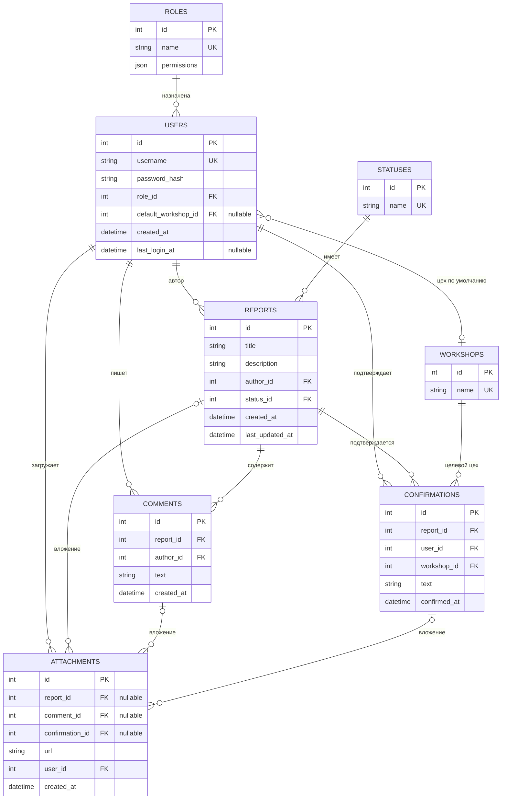

# MayakBackend
Это репозиторий с кодом сервера для MayakDefect.

## Стек технологий
- FastAPI
- SQL Alchemy
- Pydantic
- Elasticsearch

## Техдолг
- Валидация паролей методами pydantic
- Подключение к БД по пути, указанным в config.py

## ERD

